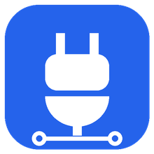

<div align="center">



# DSH MCP 管理（dsh-mcp-console）

**简体中文** · [English](README.en.md)

**在 DeepSeek Harness 里集中管理 MCP 服务器：看状态、一键启停、让 AI 从开源仓库安装、自动发现本机可接入的软件。**

</div>

## 功能

| 能力 | 说明 |
| --- | --- |
| **MCP 列表** | 侧栏新增「MCP」入口，列出当前 profile 配置的全部 MCP 服务器：名称、连接状态、传输方式、启动命令或地址、环境变量名、提供的工具、开源地址 |
| **启用 / 禁用** | 每个服务器一个开关，通过 DSH 官方插件管理器写入 profile 并立即生效，不用重启 |
| **删除** | AI 安装或导入的服务器可以一键删除：通过官方插件管理器卸载插件包，并清理它在 `mcp-bundles` 目录里的配置文件（目录外的文件一律不碰） |
| **一键导入** | 扫描到的其他客户端（Claude Desktop、Claude Code、Cursor、VS Code、Windsurf、Codex）里的 MCP，可以直接导入，不经过 AI |
| **实时刷新** | 服务器连上、断开、启停时页面自动更新，不靠定时轮询 |
| **AI 快捷添加** | 填一个 GitHub 仓库地址（可加补充说明），插件在默认工作区开一个新会话，让 AI 阅读仓库、安装、写好配置并接入，全程每一步安装都会先征求你同意 |
| **选择供应商和模型** | AI 快捷添加和联网分析都可以像模型选择器一样选供应商和模型，只对这次打开的会话生效，不改动你的默认模型 |
| **发现本机可接入的服务** | 扫描本机已安装的应用、后台服务、监听端口、Docker 容器，以及 Claude Desktop / Claude Code / Cursor / VS Code / Windsurf / Codex 里已经配置的 MCP；确认后交给 AI 联网检索哪些有 MCP 服务器，再问你要接入哪些 |
| **不泄露密钥** | 页面只显示环境变量和请求头的**名字**，参数里像密钥的值会被打码；扫描清单不含文件路径 |

## 安装

在桌面应用的**插件**页点**添加插件**，**安装源**选**官方源**，填入：

```text
dsh-mcp-console
```

安装后侧栏会出现「MCP」入口。新版本发布后 24 小时内按包名安装会被 DSH 的包管理器拒绝，可以改填 GitHub Release 的安装包地址：

```text
https://github.com/CoderKuo/dsh-mcp-console/releases/latest/download/dsh-mcp-console.tgz
```

## 使用说明

### 状态是怎么判断的

DSH 的 MCP 客户端（`@deepseek-ai/dsh-mcp-client`）不对外提供连接状态，插件按能观察到的信息判断：

| 状态 | 含义 |
| --- | --- |
| 已连接 | 正在运行，并且已经注册了 `mcp__<名称>__*` 工具 |
| 连接中 | 正在启动，或已运行但还没有工具（也可能首次连接失败、或服务器本身不提供工具，详见 DSH 日志） |
| 失败 | 加载失败（服务器配置了 `failOnStartupError: true` 时才会出现） |
| 已禁用 | 在 profile 里被关掉了 |

### 启用和禁用

开关调用 DSH 官方插件管理器的 `setPluginEnabled`，它会在 profile 的 `cordis.patch.yml` 里写 `disabled: true/false` 并立即生效。由插件包内置、或在别的配置层定义的服务器不能在这里切换，开关会显示原因。

### AI 快捷添加

1. 填仓库地址（必须是 https），可写补充说明（例如「用 Docker 运行」「API Key 在环境变量 XXX」）。
2. 点「开始安装」，插件在**默认工作区**新开一个会话并切过去。会话使用**创作模式**（agent 预设 `cordis`），因为只有它带有安装插件包的 `plugin_manager` 工具。
3. AI 会按 DSH 官方推荐的方式接入：阅读仓库 → 选择运行方式 → 本机试运行 → 在 `~/.dsh/mcp-bundles/<名称>` 写一个只含配置的 bundle → 用 `plugin_manager install_bundle` 安装 → 验证工具可用。每一步安装都需要你批准。
4. 密钥不会写成明文，AI 会用 `!!js process.env.变量名` 引用，并告诉你要设置哪些环境变量。

### 发现本机可接入的服务

1. 点「扫描本机」：只在本机读取信息，不会发给任何人。Windows 用一次 PowerShell 查询，macOS/Linux 用 `ps`、`lsof`/`ss`、`systemctl`、`/Applications`；系统组件会被过滤掉。
2. 页面列出扫描结果。确认后点「交给 AI 联网分析」，清单（不含路径和密钥）会作为消息发给你当前使用的模型，AI 联网检索后列出表格，并问你要接入哪些。确认的项目按上面同样的流程接入。

### 设置项

在 profile 的 `cordis.patch.yml` 里可以调整（行 id 为 `mcp-console`）：

| 字段 | 默认值 | 说明 |
| --- | --- | --- |
| `agentPreset` | `cordis` | AI 会话使用的 agent 预设 |
| `bundleDirectory` | 空（= `<DSH_HOME>/mcp-bundles`） | AI 写配置 bundle 的目录 |
| `scanTimeoutMs` | `20000` | 单个扫描命令的超时 |
| `repositories` | `{}` | 手动设置的开源地址，页面上编辑后自动保存 |

## 边界与安全

- 插件**不会**自己往 profile 里插入 MCP 配置，只通过官方插件管理器启停已有条目；新增一律由 AI 在你批准后用官方 `install_bundle` 完成。
- 扫描命令通过 DSH 的 `ctx.subprocess` 运行，使用其清洗过的环境变量并带超时。
- AI 会话里的提示词就是一条普通的用户消息，你看到的就是模型看到的。

## 本地开发

```sh
pnpm install
pnpm run check   # 测试 + 构建 + 打包到 .artifacts/
```

## License

[MIT](LICENSE)
